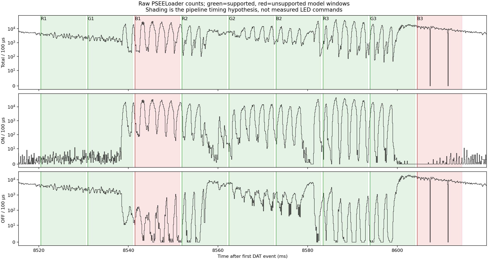
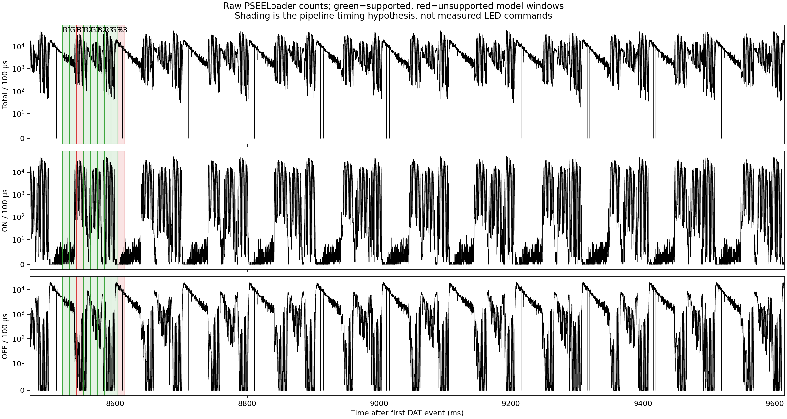

# Experiment 1: independent raw-event comparison

Recording: `10ms_4s.dat`; interval 8470400–9615000 µs after first event.
PSEELoader and the project decoder agree in every 100 µs ON/OFF bin.

The coloured windows are the saved pipeline hypothesis. LED command times and RGB identity have not been independently measured.

| Stage | Raw ON | Raw OFF | ON score | OFF score | Supported |
|---|---:|---:|---:|---:|---|
| R1 | 338 | 314163 | -0.375 | 10.045 | True |
| G1 | 128156 | 144790 | -185.356 | 2.746 | True |
| B1 | 879637 | 6642 | -113.862 | -0.250 | False |
| R2 | 207504 | 267831 | 403.361 | 1.984 | True |
| G2 | 394718 | 156433 | 497.074 | 8.202 | True |
| B2 | 381954 | 141208 | 587.912 | -18.764 | True |
| R3 | 921177 | 23910 | 581.623 | 26.591 | True |
| G3 | 277323 | 598036 | 526.615 | 18.122 | True |
| B3 | 68 | 988061 | 1.633 | 2.077 | False |

Configured RGB cycle: 31500 µs; envelope correlation at 31500 µs: -0.2773690533803467.
Strongest searched recurrence (500 µs resolution): {'lag_us': 100000, 'correlation': 0.9017751483197562}.

Support is an OR of the ON-contrast and OFF-edge tests. A strong raw response can fail when the assumed dark reference also contains activity. A supported window need not have a strong ON response.

Recurrence is event evidence, not a measurement of a particular colour or LED edge. Harmonics, scene changes and controller timing can affect it. No replacement RGB schedule or improved colour accuracy is claimed.

Spatial maps use the hypothesised response windows and share one log colour scale; raw spatial counts are in raw_counts.npz.
