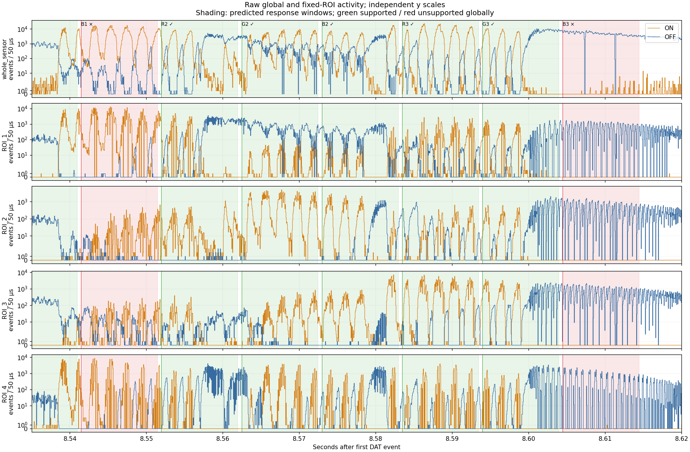
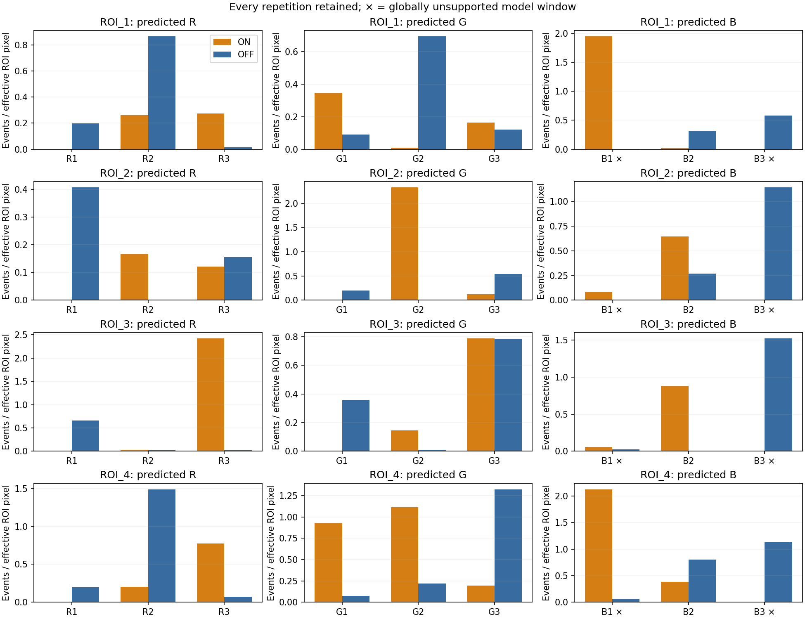
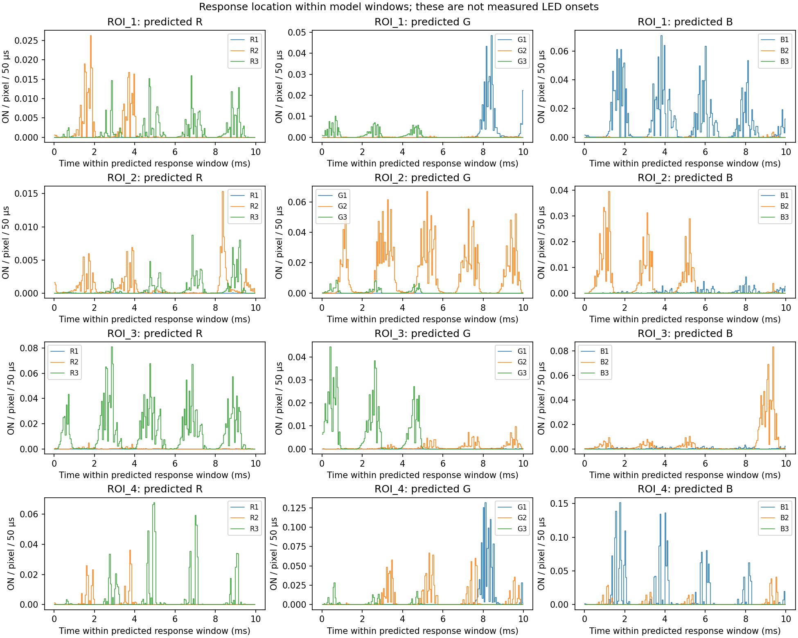
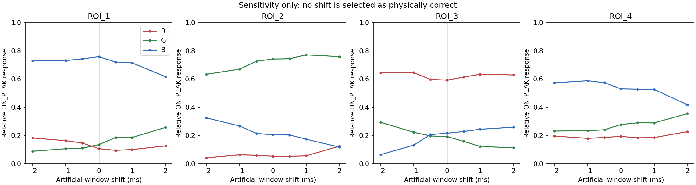

# Experiment 1D — ROI colour-response consistency

Primary ROI: **ROI_1**. ROI_1 is the saved upper ball sector. All four saved sectors are analysed separately.
No new ROI was selected. There is no whole-ball union in the baseline.

## Reproduction and implementation

The existing functions reproduce all 36 saved ON/OFF measurements and densities, all four ON_PEAK summaries (including display fields), all 36 repeatability rows, and the effective-mask overlay outside the ROI text annotation regions. Only annotation pixels differ in the rendered overlay; saved polygon coordinates and effective areas are reused exactly. Independent 50 µs histogram integration also reproduces all stage counts. See evidence.json for exact comparisons, source hashes and command.

The prior Experiment 1 detector rerun is reused; the detector is not rerun or modified here. Its saved phase is 8,520,454 µs after the first DAT event. All times below share that origin. Stage labels are **predicted colours**, not independent LED identifications.

Global phase detection uses full-sensor ON/OFF statistics, a quiet/startup comparison, fixed-schedule support and a phase-ambiguity check. It generates tj=t0+j×10500 µs here, and integrates [tj, tj+10000 µs). Polygon selection happens afterwards. The effective masks apply EXCLUDE_CONTAINED; these four have no nesting or overlaps and their areas are unchanged. ON and OFF are both counted without spatial clipping of event multiplicity, and density=count/effective pixel area.

The colour estimator takes max ON density for each predicted colour across the three repetitions, then divides by the sum of these three maxima. OFF is retained in the exports but does not enter ON_PEAK. Global support/rejection does not filter colour measurements. Display brightness/desaturation are separate and supply no correctness evidence. Mean/median comparisons below reuse run_duration_experiment.py.

## Nine stage measurements

### ROI_1

| Predicted stage | Start (µs) | End (µs) | ON count | OFF count | ON / pixel | OFF / pixel | Global timing support |
|---|---:|---:|---:|---:|---:|---:|---|
| R1 | 8520454 | 8530454 | 1 | 37296 | 0.00000530 | 0.19782948 | Supported |
| G1 | 8530954 | 8540954 | 65401 | 16917 | 0.34690706 | 0.08973298 | Supported |
| B1 | 8541454 | 8551454 | 367267 | 766 | 1.94809734 | 0.00406310 | Unsupported |
| R2 | 8551954 | 8561954 | 49258 | 163539 | 0.26127961 | 0.86746125 | Supported |
| G2 | 8562454 | 8572454 | 1914 | 130705 | 0.01015245 | 0.69329960 | Supported |
| B2 | 8572954 | 8582954 | 2949 | 60159 | 0.01564240 | 0.31910187 | Supported |
| R3 | 8583454 | 8593454 | 51493 | 2764 | 0.27313474 | 0.01466111 | Supported |
| G3 | 8593954 | 8603954 | 30725 | 22615 | 0.16297487 | 0.11995693 | Supported |
| B3 | 8604454 | 8614454 | 0 | 110078 | 0.00000000 | 0.58388763 | Unsupported |
### ROI_2

| Predicted stage | Start (µs) | End (µs) | ON count | OFF count | ON / pixel | OFF / pixel | Global timing support |
|---|---:|---:|---:|---:|---:|---:|---|
| R1 | 8520454 | 8530454 | 3 | 30276 | 0.00004039 | 0.40762033 | Supported |
| G1 | 8530954 | 8540954 | 21 | 14692 | 0.00028273 | 0.19780545 | Supported |
| B1 | 8541454 | 8551454 | 6174 | 169 | 0.08312353 | 0.00227533 | Unsupported |
| R2 | 8551954 | 8561954 | 12413 | 30 | 0.16712218 | 0.00040390 | Supported |
| G2 | 8562454 | 8572454 | 173172 | 3 | 2.33149781 | 0.00004039 | Supported |
| B2 | 8572954 | 8582954 | 47874 | 19884 | 0.64455066 | 0.26770784 | Supported |
| R3 | 8583454 | 8593454 | 8995 | 11535 | 0.12110401 | 0.15530125 | Supported |
| G3 | 8593954 | 8603954 | 8815 | 40130 | 0.11868058 | 0.54028946 | Supported |
| B3 | 8604454 | 8614454 | 0 | 85029 | 0.00000000 | 1.14478627 | Unsupported |
### ROI_3

| Predicted stage | Start (µs) | End (µs) | ON count | OFF count | ON / pixel | OFF / pixel | Global timing support |
|---|---:|---:|---:|---:|---:|---:|---|
| R1 | 8520454 | 8530454 | 0 | 56706 | 0.00000000 | 0.66121735 | Supported |
| G1 | 8530954 | 8540954 | 59 | 30570 | 0.00068797 | 0.35645989 | Supported |
| B1 | 8541454 | 8551454 | 4815 | 2009 | 0.05614506 | 0.02342584 | Unsupported |
| R2 | 8551954 | 8561954 | 2651 | 1369 | 0.03091185 | 0.01596315 | Supported |
| G2 | 8562454 | 8572454 | 12329 | 759 | 0.14376166 | 0.00885028 | Supported |
| B2 | 8572954 | 8582954 | 75905 | 292 | 0.88508629 | 0.00340485 | Supported |
| R3 | 8583454 | 8593454 | 208046 | 1567 | 2.42590951 | 0.01827192 | Supported |
| G3 | 8593954 | 8603954 | 67647 | 67312 | 0.78879431 | 0.78488806 | Supported |
| B3 | 8604454 | 8614454 | 0 | 130906 | 0.00000000 | 1.52642257 | Unsupported |
### ROI_4

| Predicted stage | Start (µs) | End (µs) | ON count | OFF count | ON / pixel | OFF / pixel | Global timing support |
|---|---:|---:|---:|---:|---:|---:|---|
| R1 | 8520454 | 8530454 | 15 | 11347 | 0.00025788 | 0.19507625 | Supported |
| G1 | 8530954 | 8540954 | 54117 | 4402 | 0.93037289 | 0.07567865 | Supported |
| B1 | 8541454 | 8551454 | 123789 | 3513 | 2.12816545 | 0.06039507 | Unsupported |
| R2 | 8551954 | 8561954 | 11703 | 86656 | 0.20119655 | 1.48977943 | Supported |
| G2 | 8562454 | 8572454 | 64714 | 12637 | 1.11255523 | 0.21725377 | Supported |
| B2 | 8572954 | 8582954 | 22263 | 46478 | 0.38274279 | 0.79904413 | Supported |
| R3 | 8583454 | 8593454 | 45177 | 4115 | 0.77667750 | 0.07074458 | Supported |
| G3 | 8593954 | 8603954 | 11351 | 77037 | 0.19514501 | 1.32441075 | Supported |
| B3 | 8604454 | 8614454 | 1 | 66020 | 0.00001719 | 1.13500782 | Unsupported |

## Repetition spread and maximum estimator

Sample CV = 100 × sample standard deviation / mean, with ddof=1 and only three observations; this is descriptive variation, not a calibrated uncertainty estimate.

| ROI | Predicted channel | Repetition 1 density | Repetition 2 density | Repetition 3 density | Maximum from | ON CV (%) | Maximum fraction of channel ON |
|---|---|---:|---:|---:|---|---:|---:|
| ROI_1 | R | 0.000005 | 0.261280 | 0.273135 | R3 | 86.66 | 51.11% |
| ROI_1 | G | 0.346907 | 0.010152 | 0.162975 | G1 | 97.27 | 66.71% |
| ROI_1 | B | 1.948097 | 0.015642 | 0.000000 | B1 | 171.14 | 99.20% |
| ROI_2 | R | 0.000040 | 0.167122 | 0.121104 | R2 | 89.82 | 57.97% |
| ROI_2 | G | 0.000283 | 2.331498 | 0.118681 | G2 | 160.76 | 95.15% |
| ROI_2 | B | 0.083124 | 0.644551 | 0.000000 | B2 | 144.55 | 88.58% |
| ROI_3 | R | 0.000000 | 0.030912 | 2.425910 | R3 | 169.95 | 98.74% |
| ROI_3 | G | 0.000688 | 0.143762 | 0.788794 | G3 | 134.97 | 84.52% |
| ROI_3 | B | 0.056145 | 0.885086 | 0.000000 | B2 | 157.96 | 94.03% |
| ROI_4 | R | 0.000258 | 0.201197 | 0.776677 | R3 | 123.60 | 79.40% |
| ROI_4 | G | 0.930373 | 1.112555 | 0.195145 | G2 | 65.10 | 49.71% |
| ROI_4 | B | 2.128165 | 0.382743 | 0.000017 | B1 | 135.54 | 84.76% |

| ROI | Estimator | Relative predicted R | Relative predicted G | Relative predicted B |
|---|---|---:|---:|---:|
| ROI_1 | ON_PEAK | 0.106355 | 0.135081 | 0.758564 |
| ROI_2 | ON_PEAK | 0.053170 | 0.741766 | 0.205064 |
| ROI_3 | ON_PEAK | 0.591716 | 0.192399 | 0.215886 |
| ROI_4 | ON_PEAK | 0.193328 | 0.276934 | 0.529737 |
| ROI_1 | ON_MEAN | 0.177066 | 0.172300 | 0.650634 |
| ROI_2 | ON_MEAN | 0.083160 | 0.706918 | 0.209922 |
| ROI_3 | ON_MEAN | 0.567225 | 0.215465 | 0.217309 |
| ROI_4 | ON_MEAN | 0.170789 | 0.390784 | 0.438426 |
| ROI_1 | ON_MEDIAN | 0.593956 | 0.370484 | 0.035559 |
| ROI_2 | ON_MEDIAN | 0.375042 | 0.367537 | 0.257422 |
| ROI_3 | ON_MEDIAN | 0.133923 | 0.622834 | 0.243243 |
| ROI_4 | ON_MEDIAN | 0.132863 | 0.614386 | 0.252750 |

Each repetition's sum-normalised vector is also in per_repeat_vectors.csv. The three maxima can come from different repetitions; the final vector need not describe any one RGB triplet. A stable-looking summary does not demonstrate repeatability. Median/mean are separate diagnostics, not validated improvements.

## B1 and B3 influence

- ROI_1: B1/B2/B3 ON counts = 367,267/2,949/0. B1 supplies the blue maximum; baseline blue component 0.758564. For a frozen-phase diagnostic excluding B1 only, blue becomes 0.024607. B3 supplies no maximum, so excluding B3 does not change ON_PEAK; its substantial OFF response is omitted by ON_PEAK.
- ROI_2: B1/B2/B3 ON counts = 6,174/47,874/0. B2 supplies the blue maximum; baseline blue component 0.205064. For a frozen-phase diagnostic excluding B1 only, blue becomes 0.205064. B3 supplies no maximum, so excluding B3 does not change ON_PEAK; its substantial OFF response is omitted by ON_PEAK.
- ROI_3: B1/B2/B3 ON counts = 4,815/75,905/0. B2 supplies the blue maximum; baseline blue component 0.215886. For a frozen-phase diagnostic excluding B1 only, blue becomes 0.215886. B3 supplies no maximum, so excluding B3 does not change ON_PEAK; its substantial OFF response is omitted by ON_PEAK.
- ROI_4: B1/B2/B3 ON counts = 123,789/22,263/1. B1 supplies the blue maximum; baseline blue component 0.529737. For a frozen-phase diagnostic excluding B1 only, blue becomes 0.168463. B3 supplies no maximum, so excluding B3 does not change ON_PEAK; its substantial OFF response is omitted by ON_PEAK.

These exclusions quantify estimator influence; they do not assert that globally unsupported windows are invalid ROI measurements and do not modify the baseline.

## Global activity inside the selected ROI

Global event fractions below are membership counts, not estimates of illumination intensity or contamination. Mask area and spatial response both affect them.

| ROI | Predicted stage | Global ON inside ROI | Global OFF inside ROI |
|---|---|---:|---:|
| ROI_1 | R1 | 0.30% | 11.87% |
| ROI_1 | G1 | 51.03% | 11.68% |
| ROI_1 | B1 | 41.75% | 11.53% |
| ROI_1 | R2 | 23.74% | 61.06% |
| ROI_1 | G2 | 0.48% | 83.55% |
| ROI_1 | B2 | 0.77% | 42.60% |
| ROI_1 | R3 | 5.59% | 11.56% |
| ROI_1 | G3 | 11.08% | 3.78% |
| ROI_1 | B3 | 0.00% | 11.14% |

For explicitly chosen 500 µs observational intervals:

| Start (µs) | End (µs) | Polarity | Global events | Primary ROI events | Fraction inside |
|---:|---:|---|---:|---:|---:|
| 8598565 | 8599065 | ON | 37983 | 4862 | 12.80% |
| 8604585 | 8605085 | OFF | 71346 | 6337 | 8.88% |
| 8607585 | 8608085 | OFF | 64149 | 5399 | 8.42% |

The OFF-band pattern is visible inside the unchanged primary polygon in observed_spatial_activity.png. Its physical cause remains unknown. These 500 µs intervals do not reproduce player frames of unknown duration and do not establish physical LED transition times.

One-millisecond intervals around the reported player timestamp 8.600835 s:

| Region | Start (µs) | End (µs) | ON | OFF |
|---|---:|---:|---:|---:|
| whole_sensor | 8599835 | 8600835 | 9 | 76028 |
| ROI_1 | 8599835 | 8600835 | 4 | 1775 |
| whole_sensor | 8600835 | 8601835 | 3 | 145085 |
| ROI_1 | 8600835 | 8601835 | 3 | 3661 |

The trace changes from strong ON bursts to OFF dominance in both regions. Both intervals immediately around the reported timestamp are already OFF-dominated, so 8.600835 s should not be treated as an exact transition edge. transition_zoom.png shows the surrounding 50 µs bins. The player frame convention and integration duration are not independently available here.

## Position of responses within predicted windows

The largest integrated 1 ms ON slice and ON-weighted centroid are descriptive response locations, not onset estimates. Each centroid uses 50 µs bin centres. A location based on only a few events is not a reliable response feature.

| Primary predicted stage | ON count | Largest 1 ms slice begins at (µs) | ON centroid (µs) |
|---|---:|---:|---:|
| R1 | 1 | 1000 | 1625.0 |
| R2 | 49258 | 1000 | 2550.9 |
| R3 | 51493 | 6000 | 6200.0 |
| G1 | 65401 | 8000 | 8472.6 |
| G2 | 1914 | 7000 | 6154.6 |
| G3 | 30725 | 0 | 2409.4 |
| B1 | 367267 | 1000 | 4548.1 |
| B2 | 2949 | 9000 | 7234.5 |
| B3 | 0 | undefined | undefined |

Nonconstant pairwise log-ON profile correlations for the primary ROI range from -0.429 to -0.052; zero/constant profiles have undefined correlations. The strong responses are not consistently located at the same relative stage positions. All sectors' phase summaries and profile correlations are exported separately.

## Artificial shift sensitivity

Performed after A–E established large ON variation. Every mask, integration duration, stage spacing and estimator is held fixed; all shifted windows fit the recording. Original support labels are not rescored. These are artificial perturbations, not candidate physical LED alignments.

For ROI_1:

| Shift (ms) | ON_PEAK R | ON_PEAK G | ON_PEAK B | L1 vector change | ON CV R/G/B (%) |
|---:|---:|---:|---:|---:|---|
| -2 | 0.182235 | 0.087909 | 0.729856 | 0.151759 | 106.11/135.19/172.27 |
| -1 | 0.163278 | 0.105748 | 0.730974 | 0.113847 | 99.79/93.33/172.32 |
| -0.5 | 0.146816 | 0.110145 | 0.743039 | 0.080921 | 91.71/93.07/171.38 |
| +0 | 0.106355 | 0.135081 | 0.758564 | 0.000000 | 86.66/97.27/171.14 |
| +0.5 | 0.094485 | 0.185308 | 0.720207 | 0.100455 | 86.70/120.00/171.28 |
| +1 | 0.100008 | 0.185904 | 0.714088 | 0.101646 | 87.10/130.35/171.30 |
| +2 | 0.126009 | 0.257175 | 0.616816 | 0.283496 | 112.35/137.04/170.13 |

All ROIs, repetitions, ON/OFF counts, densities, estimator vectors, signed component changes and repeatability are exported in sensitivity_*.csv. No shift is selected as correct.

## Answers and next priority

1. **Extraction functions as implemented:** exact reproduction and independent histogram checks support counting, mask membership, area normalisation and ON_PEAK arithmetic. This does not validate the physical colour labels.
2. **Same-colour repetitions are not reasonably repeatable in this saved sequence:** see large ON CVs and the individual rows; no statistical acceptance threshold is inferred from three repeats.
3. **B1/B3 influence is ROI-dependent:** B1 sets some blue maxima, while other sectors use B2. B3 has almost no ON response and does not set a blue maximum, but its OFF response remains substantial.
4. **The maximum summary conceals variation if reported alone:** it discards the two smaller responses per channel. The existing repeatability and per-repeat exports reveal this variation when examined.
5. **Some unusual activity lies inside the selected polygon:** membership fractions and spatial snapshots quantify it; outside events cannot directly enter the ROI counter. Global statistics can still affect its predicted timing.
6. **These predicted windows yield unstable ROI measurements:** repetition/profile variation and the optional phase perturbation quantify instability. They do not isolate timing error from optical variation, motion, or other camera-response effects.
7. **Unresolved:** physical RGB identity, actual LED edges, optical waveform, clock relation, sensor response latency and absolute colour accuracy. Event peaks alone cannot resolve them.

**Next priority: independently measure the illumination and its timing relative to camera events, then evaluate temporal validation against that reference.** Preserve this fixed-schedule baseline. No evidence here requires reimplementing ROI extraction or choosing a new RGB period. Calibrated colour evaluation follows a validated timing reference; adjusting summary estimators alone does not establish correct colour.
