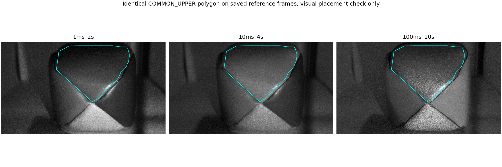
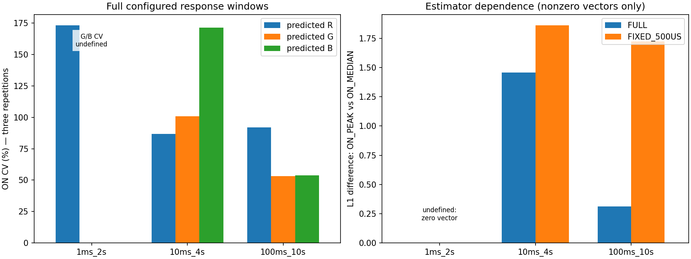
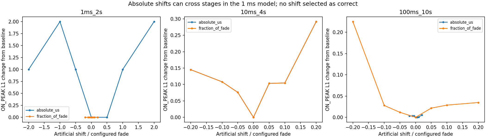

# Experiment 2A — cross-recording repeatability

All labels are predicted illumination colours. No configured RGB period, detector or colour-mapping algorithm was changed.

## Shared ROI and provenance

COMMON_UPPER is the saved 169,996-pixel upper-ball polygon from the 100 ms archive. Its coordinates are identical across recordings. This is a diagnostic ROI transfer with a visual overlay check, not verified pixel/material registration. It differs from Experiment 1D's 188,526-pixel ROI_1. Original 1D outputs remain intact. The 1 ms archive lacks ROI coordinates/response CSVs, so no reproduction of its original spatial selection is claimed.

The 100 ms archive says data/example.dat. Its event count, span, complete saved 1 ms global histogram and native ROI counts agree with 100ms_10s.dat. The 1 ms and 100 ms unchanged detectors were rerun and reproduced saved onsets and per-stage support scores. The 10 ms 7/9 case reuses the previously verified phase after its original 4.5 s skip; the two other searches start at the beginning. Different search histories remain a confound.

Independent PSEELoader decoding covers all three full recordings. Every saved 1 ms OFF/ON global bin and every exact FULL ROI stage count agrees with the project reader/counter. See evidence.json. The 100 ms native ROI response CSV is also reproduced. Sparse/zero ON counts are reported; undefined CVs and zero-sum vectors must not be interpreted as stable colour estimates.

## FULL response-window comparison

| Recording | Configured RGB cycle (ms) | Supported | Failed predicted stages | ROI ON / OFF total | ON CV R/G/B (%) | Peak–median L1 |
|---|---:|---:|---|---:|---|---:|
| 1ms_2s | 4.5 | 6/9 | B1,R2,R3 | 1 / 54,015 | 173.21 / undefined / undefined | 1.000000 |
| 10ms_4s | 31.5 | 7/9 | B1,B3 | 526,683 / 506,848 | 86.73 / 100.76 / 171.54 | 1.458711 |
| 100ms_10s | 301.5 | 8/9 | R2 | 1,832,291 / 1,307,704 | 92.08 / 53.27 / 53.77 | 0.311924 |

| Recording | Window mode | Estimator | Relative predicted R | G | B | Nonzero vector |
|---|---|---|---:|---:|---:|---|
| 1ms_2s | FULL | ON_PEAK | 1.000000 | 0.000000 | 0.000000 | True |
| 1ms_2s | FULL | ON_MEAN | 1.000000 | 0.000000 | 0.000000 | True |
| 1ms_2s | FULL | ON_MEDIAN | 0.000000 | 0.000000 | 0.000000 | False |
| 1ms_2s | FIXED_500US | ON_PEAK | 0.000000 | 0.000000 | 0.000000 | False |
| 1ms_2s | FIXED_500US | ON_MEAN | 0.000000 | 0.000000 | 0.000000 | False |
| 1ms_2s | FIXED_500US | ON_MEDIAN | 0.000000 | 0.000000 | 0.000000 | False |
| 10ms_4s | FULL | ON_PEAK | 0.103585 | 0.137265 | 0.759150 | True |
| 10ms_4s | FULL | ON_MEAN | 0.172098 | 0.172977 | 0.654925 | True |
| 10ms_4s | FULL | ON_MEDIAN | 0.590191 | 0.380014 | 0.029795 | True |
| 10ms_4s | FIXED_500US | ON_PEAK | 0.044444 | 0.741414 | 0.214141 | True |
| 10ms_4s | FIXED_500US | ON_MEAN | 0.071008 | 0.720250 | 0.208742 | True |
| 10ms_4s | FIXED_500US | ON_MEDIAN | 0.975000 | 0.000000 | 0.025000 | True |
| 100ms_10s | FULL | ON_PEAK | 0.173085 | 0.380913 | 0.446002 | True |
| 100ms_10s | FULL | ON_MEAN | 0.133042 | 0.361900 | 0.505057 | True |
| 100ms_10s | FULL | ON_MEDIAN | 0.111294 | 0.286742 | 0.601964 | True |
| 100ms_10s | FIXED_500US | ON_PEAK | 0.003969 | 0.950428 | 0.045603 | True |
| 100ms_10s | FIXED_500US | ON_MEAN | 0.004042 | 0.930433 | 0.065526 | True |
| 100ms_10s | FIXED_500US | ON_MEDIAN | 0.003704 | 0.088889 | 0.907407 | True |

FULL uses the configured 1/10/100 ms response duration. FIXED_500US is a separate existing-framework diagnostic: the first 500 µs after each predicted onset, with identical masks/spacing/phase and original global support labels. Channel_repeatability.csv contains ON, OFF and TOTAL CVs for both window modes. Equal 500 µs intervals control integration duration but may sample different response phases; they do not validate LED timing.

**Degenerate estimates:** the 1 ms FULL maximum vector [1,0,0] comes from just one ON event, while its median vector is all zero. Their arithmetic L1 difference of 1 in comparison.csv is not a valid distance between two measured colour signatures. All-zero vectors are omitted from the estimator-distance plot. Undefined G/B CVs are not zero variability. The unchanged [1,0,0] under small fractional shifts is a one-event normalisation effect, not evidence of robust colour.

## Event recurrence

500 µs log ON/OFF envelopes, centred independently per polarity at each lag. Correlations describe event recurrence, not RGB identity. Broad search starts at 5 ms to avoid near-zero smoothness and ends at min(2 s, one third of the section). The configured cycle is also tested separately, including the 4.5 ms model. Interior local maxima and possible harmonics are exported; the strongest lag is not necessarily a unique period.

Five deterministic sections per recording: whole file, t0−0.5 to t0+3 s, and up to 4 s from each third of the remaining post-phase stream. Boundaries are trimmed to complete 500 µs bins. Whole-file statistics can mix startup, inactive and active regimes; inspect section agreement and the plots.

| Recording | Selected context strongest searched lag (ms) | Correlation | Correlation at configured RGB cycle |
|---|---:|---:|---:|
| 1ms_2s | 202.0 | 0.860 | 0.420 |
| 10ms_4s | 909.0 | 0.964 | -0.273 |
| 100ms_10s | 329.0 | 0.903 | -0.527 |

## Artificial timing shifts

Two explicitly separate schemes use unchanged FULL windows: absolute −2/−1/−0.5/0/+0.5/+1/+2 ms; and −20/−10/−5/0/+5/+10/+20% of configured fade duration. The absolute ±2 ms shifts exceed the 1 ms stage spacing and are not small local errors for that model. Per-stage counts, densities, repeatability and estimator vectors are exported. Support scores are not recomputed for artificial shifts. No shift is selected as correct.

| Recording | Scheme | Maximum tested ON_PEAK L1 change |
|---|---|---:|
| 1ms_2s | absolute_us | 2.000000 |
| 1ms_2s | fraction_of_fade | 0.000000 |
| 10ms_4s | absolute_us | 0.291492 |
| 10ms_4s | fraction_of_fade | 0.291492 |
| 100ms_10s | absolute_us | 0.005573 |
| 100ms_10s | fraction_of_fade | 0.225084 |

## Interpretation limits

One recording per nominal duration, one selected nine-stage sequence, unverified physical RGB identity, different detector search histories, possible spatial misregistration and changing integration duration prevent a causal ranking of illumination-duration robustness. Low event counts can yield zero medians, undefined CVs or highly variable normalised vectors. Lower CV alone does not establish a useful colour response. Hardware timings and colour ground truth remain unmeasured.

The original ROI counting, ON_PEAK rule and existing mean/median estimators are reused. Global support does not filter ROI measurements. Use the nine_stage_responses.csv and plots in each recording directory to interpret support failures directly.

For the evidence-based interpretation and reproduction commands, see docs/experiment_2a.md in the repository.
