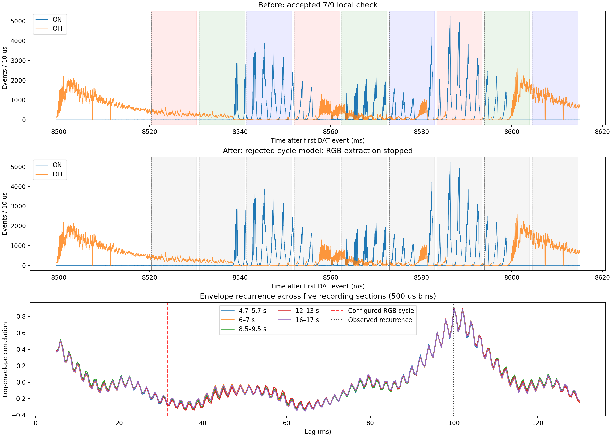
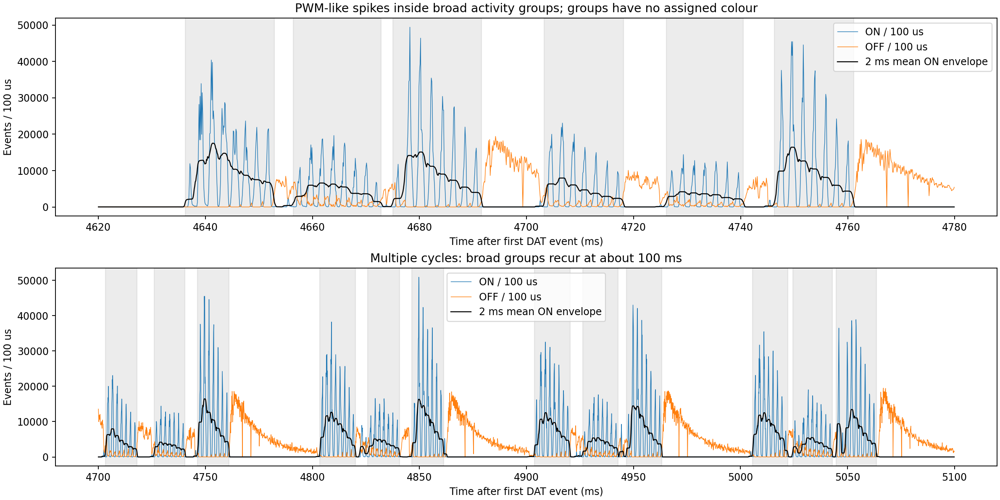

# Temporal synchronisation investigation — 10ms_4s.dat

The configured timing is incompatible with the recurring event envelope. The
implemented correction rejects the false timing pass and stops RGB extraction.
It does **not** claim to have recovered LED command times or corrected colours.

## Data and reproduction

The DAT contains 869,677,564 events, with its first raw timestamp at 1,835 us.
The decoder reads polarity from bit 28 (0=OFF, 1=ON); no polarity inversion was
introduced. The full detector checks chronological order while scanning chunks.
All times below are relative to the first DAT event, not the raw timestamp.

The saved run `20261022_125050_727915` is the requested 7/9 case: requested skip
4,500,000 us, actual first retained event 4,500,004 us. The other open run,
`20261022_125851_330700`, has zero skip and an 8/9 result. The working runner
currently also has zero skip. Its existing user edits were preserved.

Run `MPLBACKEND=Agg python diagnose_temporal_sync.py` to rebuild the evidence and
plots (the first run reads the 6.5 GB DAT; later runs use an ignored histogram
cache). `corrected_detection.json` reproduces the exact saved fine-search block,
including its 4 us bin-origin displacement. `pipeline_check/` records a complete
rerun of `detect_flash_onsets_chunked` with the requested 4.5 s skip. Neither run
uses interactive ROI selection. Cached full-file histograms have 10 us bins;
exact-block correlations therefore differ slightly from cache-based values.

## Sign conventions and the false pass

The actual code uses:

```
t0 = detected_candidate + sync_offset_us
tj = t0 + j * flash_period_us + (j // 3) * cycle_extra_delay_us
response = [tj + response_delay_us,
            tj + response_delay_us + response_window_us)
```

A positive sync offset moves every window **later**. A positive response delay
also moves the integration window later. The reader subtracts the actual read
start; exports add that same start back. There is no sign reversal in response
extraction, and intervals are consistently half open. The response end validation
checks the adjacent-stage period, rather than certifying the physical illumination
duration. The plotted illumination endpoint currently uses the fade duration;
peak hold would also need consideration in any nonzero-hold experiment.

The old accepted candidate is at 8,520,454 us, or 4,020,450 us after read start.
Its local metrics reproduce exactly: 7 supported flashes, rank 5.9951875721,
sequence ON score 48.3295865181, sequence OFF score 21.2727538293. Ten earlier
ambiguous activity groups were skipped in that block alone. Broad activity after
the requested skip begins around 4,636,200 us. Consequently the selected candidate
is not evidence of the initial physical RGB phase.

The old score accepts each stage when **either** the ON contrast or a narrow OFF
edge is strong. Its startup baseline compares preceding ON counts with inferred
late-dark counts from the candidate schedule. With the wrong schedule, those
reference bins can themselves contain strong illumination activity. This allows
an active later interval to appear quiet by comparison. A narrow score maximum
and 7/9 support do not validate the assumed duration, period or colour identity.

## Observations independent of RGB labels

The first broad ON groups after the requested skip, at an envelope threshold of
1,000 ON events per 100 us and a 2 ms averaging window, are:

| Group | Start (us) | End (us) | Envelope duration (us) |
|---|---:|---:|---:|
| 1 | 4,636,200 | 4,652,900 | 16,700 |
| 2 | 4,656,400 | 4,672,800 | 16,400 |
| 3 | 4,675,000 | 4,691,600 | 16,600 |
| 4 | 4,703,300 | 4,718,100 | 14,800 |
| 5 | 4,726,100 | 4,740,500 | 14,400 |
| 6 | 4,746,300 | 4,761,100 | 14,800 |

These are **activity-envelope crossings**, not LED command edges. Their onset
spacings are 20.2, 18.6, 28.3, 22.8 and 20.2 ms, incompatible with treating every
10.5 ms as a new colour. Threshold sensitivity at 500, 1,000 and 2,000 events is
exported in `observed_activity_groups.csv`; some groups fragment as the threshold
increases. No group was independently shifted to a local maximum.

Inside the first group, the strongest spike recurrence searched over 1.5–2.5 ms
is 2.12 ms. This is consistent with PWM-like modulation, although a controller
trace is needed to establish its cause. Multiple spikes are within a single
broad group, so individual ON peaks cannot be treated as successive LED onsets.

Log ON/OFF envelopes, aggregated in 500 us bins and centred separately per
polarity, give the following lag correlations. Refining the broad recurrence
search to 100 us bins gives 100.1 ms in every section.

| Recording section | Correlation at 31.5 ms | Correlation at 100 ms | Refined recurrence |
|---|---:|---:|---:|
| 4.7–5.7 s | -0.283 | 0.890 | 100.1 ms |
| 6–7 s | -0.268 | 0.896 | 100.1 ms |
| 8.5–9.5 s | -0.268 | 0.906 | 100.1 ms |
| 12–13 s | -0.280 | 0.904 | 100.1 ms |
| 16–17 s | -0.267 | 0.898 | 100.1 ms |

Thus there is stable recurrence at roughly 100 ms across the recording. There is
no detectable change of this local estimate at 100 us search resolution; this
is not an upper bound on hardware jitter or cumulative drift. The 68.6 ms
mismatch against the configured 31.5 ms RGB cycle cannot be repaired with one
constant offset. Even placing the configured schedule at the first observed
activity yields negative adjacent-cycle correlations (-0.170 and -0.105).

The exact old 7/9 candidate has adjacent-cycle envelope correlations of -0.06385
and -0.23780. At 8,520,454 us the proposed R1 window is on an OFF decay, with ON
bursts later. This fact alone would not establish an error; the incompatible
cycle recurrence and the duration evidence are the stronger tests.

## Code correction and validation

- `src/temporal_alignment.py`: adds `evaluate_cycle_recurrence`, a configurable
  minimum correlation (default 0.3), and `TimingModelMismatchError`. After local
  scoring and the global offset, complete adjacent RGB-cycle envelopes must
  recur. Log scaling limits spike amplitude dominance; bins up to 500 us reduce
  fine PWM phase sensitivity. ON and OFF are retained and centred separately.
  Constant-polarity imbalance cannot pass. The existing physical RGB sequence
  and fixed onset formula are preserved. No replacement offset is inserted.
- `src/flash_detection.py`: saves the rejection report and raw-event plot and
  stops on this model mismatch, rather than continuing until some later unrelated
  candidate passes. ROI extraction and colour mapping are never reached.
- `diagnose_temporal_sync.py`: independent, reproducible histogram, activity,
  recurrence, exact-block reproduction and before/after plotting.
- `tests/test_temporal_alignment.py`: four tests cover repeating PWM envelopes
  with amplitude changes, unrelated activity, constant polarity imbalance and
  the offset/cycle-delay schedule. All four pass. The full 4.5 s skip detector
  rerun rejects the exact previously accepted 7/9 candidate as intended.

The correlation threshold is an explicit conservative heuristic, not a calibrated
probability. Motion or changes between cycles can cause rejection of correct
controller timing. A single configured RGB repeat cannot supply this check.
Passing recurrence still does not prove the absolute phase or RGB identity.

## Response consistency and remaining uncertainty

Across the same four saved ROI masks, the original R1 has 19 ON versus 135,625
OFF events; R2 has 76,025 ON and R3 has 313,711 ON. The saved 12 ROI/colour ON
coefficients of variation have median 135.254% (range 65.104–171.140%). This
quantifies poor original repeatability, but does not identify a correct phase.

**No improved RGB consistency is claimed.** After the correction there is no
accepted RGB schedule and no new RGB vector. Optimising a shift to reduce CV
would be circular evidence. The two before/after panels show the same raw events:
the old coloured assignments become a rejected grey timing hypothesis.

The recording supports a wrong timing model and an unsupported initial phase,
but does not uniquely separate ramp duration, PWM effects, dark interval,
controller overhead and extra cycle delay. In particular, 100.1 ms recurrence
is not sufficient to set a new per-colour period, and the 15–20 ms event groups
do not prove that a nominal 10 ms fade was implemented twice. There is no
controller source, trigger channel or colour-labelled calibration in the repo
that establishes those facts. A controller command log or photodiode/trigger
measurement plus a known first-red reference is needed for a justified numeric
replacement schedule. The skip also discards earlier recording activity, so
first-red identity cannot be assumed from the retained data alone.




